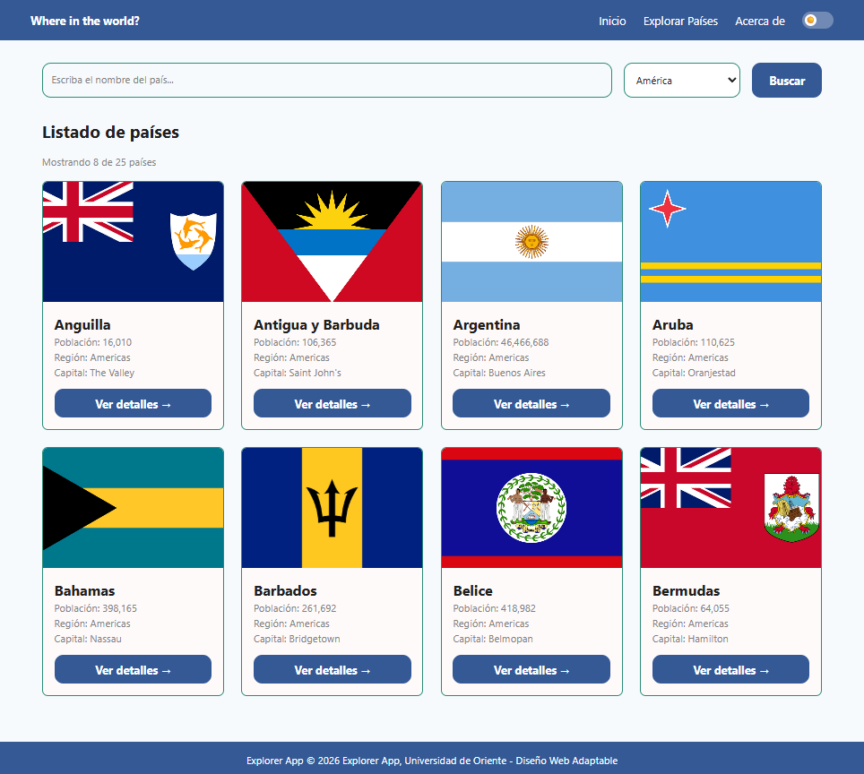

# Explore App

Aplicación web adaptable (responsive) para explorar países del mundo: permite buscar por nombre y filtrar por región. Proyecto de la materia Diseño Web Adaptable (UNIVO), basado en un diseño hecho en Figma.

🔗 **Producción:** (https://explore-app-delta.vercel.app)
🏷️ **Versión Vanilla TypeScript entregada:** [entrega-lab-2](https://github.com/Wippomonster/explore-app/tree/entrega-lab-2)



## Stack

- Vite + TypeScript (sin frameworks)
- Tailwind CSS v4 (tokens con `@theme`, modo oscuro con clase `dark`)
- pnpm
- API: RestCountries v5
- Despliegue: Vercel

## Requisitos

- Node.js 20 o superior
- pnpm

## Cómo ejecutarlo

```bash
git clone https://github.com/Wippomonster/explore-app.git
cd explore-app
pnpm install
```

Crea tu archivo de configuración copiando el ejemplo:

```bash
copy .env.example .env.local
```

Abre `.env.local` y escribe tu clave de RestCountries:

```
VITE_RESTCOUNTRIES_API_KEY=tu_clave
```

Luego:

```bash
pnpm dev      # servidor de desarrollo
pnpm build    # build de producción
pnpm preview  # previsualizar el build
```

## Organización de carpetas

| Ruta | Contenido |
|---|---|
| `src/types/` | Interfaces de TypeScript (`Country`) |
| `src/api/` | Llamada a la API y validación de la respuesta |
| `src/utils/` | Formato de datos, filtro y debounce |
| `src/render/` | Funciones que crean las tarjetas y los estados (cargando, vacío, error) |
| `src/main.ts` | Coordina tema, menú y la lista de países |
| `src/pages/` | Páginas de listado y detalle |
| `Capturas FIGMA/` | Imágenes de referencia del diseño |
| `docs/` | Capturas para la documentación |

## Fuente de datos y configuración

Los datos vienen de [RestCountries v5](https://restcountries.com). Se piden solo los primeros 25 países. La API requiere una clave que se guarda en `.env.local` (no se sube al repositorio). La clave debe tener permitido el origen (`localhost` para desarrollo y el dominio de Vercel para producción) en el panel de RestCountries. Nota: como es una app de navegador, la clave queda visible en el código compilado. No se usó un JSON del profesor.

## Flujo de trabajo

- `main` es la rama de producción y está protegida: los cambios entran solo por Pull Request.
- Se trabaja en ramas cortas (`feat/...`, `fix/...`, `docs/...`).
- Commits con Conventional Commits (`feat:`, `fix:`, `refactor:`, `docs:`).
- Cada PR genera una URL de preview en Vercel; al hacer merge a `main` se despliega a producción.

## Enlaces del flujo

- Pull Request integrado: (https://github.com/Wippomonster/explore-app/pull/1)
- URL de preview: https://explore-app-git-fix-nombre-largo-tarjeta-univo2.vercel.app